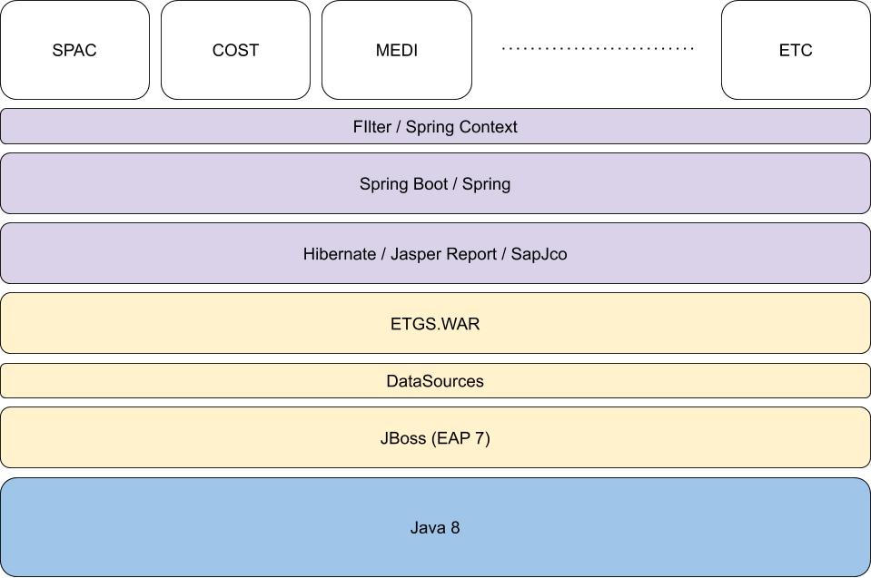
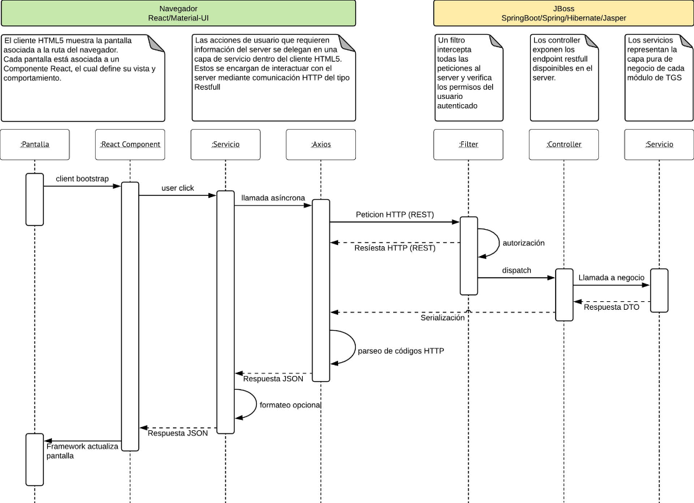

# Arquitectura TGS

- **Origen:** [TGS013 - Arquitectura — Confluence](https://baufest.atlassian.net/wiki/spaces/TGS400/pages/3563880662/TGS013+-+Arquitectura)
- **Fecha de importación:** 2026-10-19
- **Método de importación:** texto e imágenes proporcionados por el usuario; no se consultó Confluence.
- **Versión y última modificación en Confluence:** no informadas.
- **Estado de la importación:** texto y dos diagramas importados.

## Notas de conversión

Se reconstruyeron las tablas y la jerarquía de listas a partir del texto
proporcionado. En Diseño Técnico se usaron columnas de área, tema, componente
y versión para representar las agrupaciones originales; los encabezados
repetidos se omitieron. La versión de JUnit / Mockito no estaba informada.

Los nombres de tecnologías, versiones y temas se conservan como documentación
de origen: no se verificó su vigencia contra los repositorios ni se actualizaron.
Se conservó el tema «Actuación» tal como fue recibido.
Los diagramas se recibieron como imágenes PNG y se copiaron sin modificaciones
a recursos locales. Por el orden de los adjuntos, la primera imagen corresponde
a `Untitled drawing (1).jpg` (Vista Conceptual) y la segunda a
`TGS secuencia.jpeg` (Vista Lógica), nombres mencionados en el texto de origen.
No se convirtieron a JPG ni se reconstruyó su contenido.

## Objetivo

Proporcionar una descripción general de la arquitectura de la aplicación. Esta arquitectura utiliza diferentes enfoques y describe las decisiones arquitectónicas más importantes relacionadas con el desarrollo de soluciones técnicas.

## Temas de arquitectura

La siguiente tabla describe los temas de arquitectura que guían el diseño de la solución técnica. Cada tema tiene requisitos asociados para guiar nuestras decisiones durante el desarrollo de la solución.

| # | Tema | Descripción |
|---|---|---|
| #1 | Integración | Sugerir y consultar con el cliente las mejoras que podríamos desarrollar para potenciar la aplicación. |
| #2 | Usabilidad | La solución debería: - Ser intuitivo y fácil de usar. - Centrarse en los usuarios finales. - Tener una apariencia renovada |
| #3 | Portabilidad | Se requiere que la aplicación sea: - Disponible para los navegadores más comunes entre los usuarios. - Utilizable en PC. |
| #4 | Seguridad | El diseño de la aplicación cumplirá con los estándares de seguridad del cliente informados durante el inicio del proyecto. |
| #5 | Actuación | - Desarrollar un producto ágil y rápido en tiempos de ejecución razonables. - Es importante cuidar los tiempos de respuesta cuando la importación de datos está disponible y es necesaria. |
| #6 | Fiabilidad | La aplicación debe: - Ser robusto y confiable. - No fallar en situaciones predecibles o previamente conocidas. - Alertar si la aplicación sigue funcionando (o no) mientras se ejecutan los procesos a largo plazo. - Ser coherente con los datos que se muestran en las pantallas de diferentes dispositivos. |
| #7 | Auditoría | La aplicación debe registrar todos los errores y eventos que puedan ocurrir a lo largo de su ejecución. |

## Vistas Arquitectónicas

### Vista Conceptual

En esta sección, presentamos cada módulo conceptual, incluidas sus responsabilidades e interacciones, en un nivel abstracto.

En el siguiente diagrama se ven los componentes principales de stack tecnológico y piezas de software en una vista apilada indicando que bloque brinda soporte a los demás.

- En azul se ve la capa de ejecución constituida por la JVM la cual es agnóstica al sistema operativo
- En amarillo esta la capa infraestructura donde se despliega la aplicación, constituida por el servidor de aplicaciones que da soporte a los recursos compartidos como los datasources y la aplicación empaquetada con todas su dependencias
- En violetas figuran los componentes de framework instanciados por la aplicación (.war). Sobre estos se configuran las librerías base de persistencia, acceso a datos, etc.
- En blanco figuran los componentes de propios dela implementación de TGS.

### Vista Lógica

En esta sección, presentamos los elementos lógicos, incluidas las relaciones e interacciones, y cómo se distribuyen las responsabilidades del sistema.

### Vista de desarrollo

La vista de desarrollo ilustra un sistema desde la perspectiva de un programador y se refiere a la gestión del software. Esta vista también se conoce como la vista de implementación.

#### Diseño Técnico

| Área | Tema | Componente | Versión |
|---|---|---|---|
| Backend | Lenguaje Principal | Java | 1.8 |
| Backend | Frameworks | Spring Boot / Maven | 2.1.1.RELEASE / 3.8.7 |
| Backend | Development Interface | IntelliJ | Latest |
| Backend | Tests Unitarios | JUnit / Mockito | No informada |
| Frontend | Lenguaje Principal | JavaScript | ES6 |
| Frontend | Framework | React | 16.8.0 |
| Frontend | Framework CSS | Material UI | 4.9.10 |
| Frontend | Development Interface | Visual Studio Code | Latest |
| Frontend | Tests Unitarios | JEST | 23.6.0 |
| Data Access and Configuration | Database | Oracle | 19 |
| Log and Event Registration | Log | Log4J | - |

### Vista de proceso

Los aspectos tratados en este tópico son transparentes a Baufest ya que la infraestructura y el proceso de despliegue a producción son responsabilidad del cliente.

### Vista Física

Los aspectos tratados en este tópico son transparentes a Baufest ya que la infraestructura y el proceso de despliegue a producción son responsabilidad del cliente.
